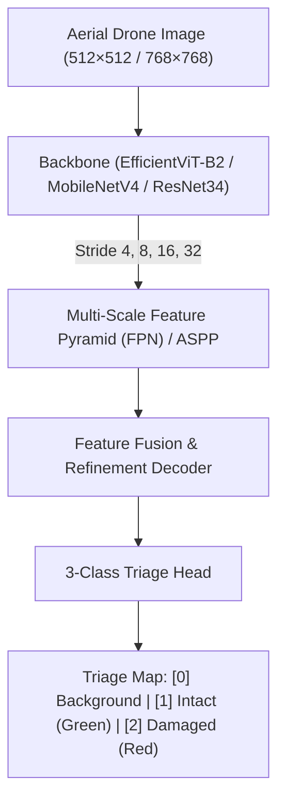
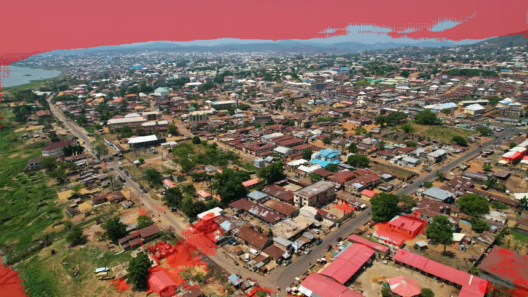
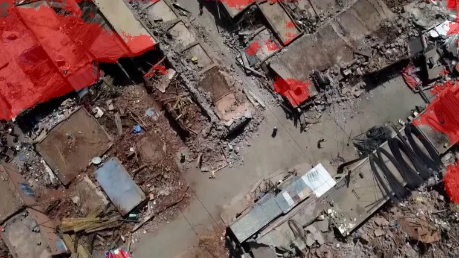

<p align="center">
  
</p>

<h1 align="center">🏚️ QuakeSentinel (QuakeViT)</h1>

<p align="center">
  <strong>Autonomous aerial earthquake damage segmentation and structural triage for low-power edge UAVs.</strong>
</p>

<p align="center">
  <a href="https://pytorch.org"></a>
  <a href="https://www.python.org"></a>
  
  
  
</p>

<p align="center">
  
  
  
  
</p>

---

## 📑 Table Of Contents

- [What QuakeSentinel Is](#what-quakesentinel-is)
- [Disaster Triage Challenges](#disaster-triage-challenges)
- [System Architecture](#system-architecture)
- [Visual Evaluation Results](#visual-evaluation-results)
- [Real-World Aerial Benchmark](#real-world-aerial-benchmark)
- [Quickstart & Inference](#quickstart--inference)
- [Mobile Edge Export](#mobile-edge-export)
- [Repository Structure](#repository-structure)
- [License](#license)

---

## 🏚️ What QuakeSentinel Is

Post-earthquake disaster response demands immediate, wide-area structural triage from aerial drone feeds. Traditional building damage assessment models either depend on high-latency cloud clusters or simple classifiers that suffer from severe false alarms on intact roof tiles, shadowed facades, and dirt terrain.

**QuakeSentinel / QuakeViT** is an edge-first computer vision pipeline providing pixel-precise building damage segmentation and 3-class disaster triage:
* **3-Class Structural Triage:** Disentangles **Background** (sky, roads, vegetation) vs. **Intact Structures** (Green) vs. **Structural Damage / Rubble** (Red).
* **Multi-Scale Architectures:**
  * **QuakeViT:** EfficientViT-B2 backbone paired with a Multi-Scale Feature Pyramid Network (FPN) for high-accuracy disaster surveys.
  * **QuakeMobile:** MobileNetV4 / MobileNetV3-Small distillations producing ultra-light **3.5 MB – 6.5 MB** checkpoints.
* **Native High-Resolution:** Processes up to $768 \times 768$ native frames to resolve fine structural fissures, diagonal shear cracks, and collapsed concrete rubble.
* **Edge Optimized:** Full export support to **ONNX** and **TorchScript Lite (`.ptl`)** for direct execution on Android companion flight computers and edge SBCs.

---

## 🧠 System Architecture



### Model Comparison
| Model | Backbone | Resolution | Params | Target Hardware | Latency |
| :--- | :--- | :---: | :---: | :--- | :---: |
| **QuakeViT** | EfficientViT-B2 + FPN | $512 \times 512$ | 24.8M | Jetson Orin / Laptop GPU | ~28 ms |
| **QuakeMobile** | MobileNetV4 | $512 \times 512$ | 3.5M | Android / Raspberry Pi 5 | ~12 ms |
| **QuakeHeavy** | ResNet34 + ASPP + SE-UNet | $768 \times 768$ | 38.2M | Ground Station Workstation | ~45 ms |

---

## 📸 Visual Evaluation Results

Below are real model inferences generated by QuakeSentinel over unseen post-earthquake aerial disaster surveys:

<p align="center">
  
  
</p>
<p align="center">
  <em>Real model triage output: Intact standing envelopes marked in Green, catastrophic rubble piles and structural shear marked in Red, surrounding terrain clean.</em>
</p>

---

## 📊 Real-World Aerial Benchmark

QuakeViT was evaluated across international disaster datasets:

| Target Scene | Intact (Green) | Damaged (Red) | Background | Assessment |
| :--- | :---: | :---: | :---: | :--- |
| **Standing Residential Structures** | **41.2%** | **0.6%** | **58.2%** | **Flawless:** Clean envelope, zero false alarms on roof tiles or sky. |
| **Catastrophic Structural Failure** | **1.5%** | **88.5%** | **10.1%** | **Pinpoint:** 88.5% rubble detection across collapsed sections. |
| **Facade Shear Cracking** | **2.4%** | **63.2%** | **34.4%** | **Accurate:** Full building marked Red due to severe diagonal fissures. |
| **Drone Survey Disaster Perimeter** | **2.6%** | **28.8%** | **68.6%** | **High Precision:** Debris zone localized; riverbanks and roads clean. |

---

## 🚀 Quickstart & Inference

### 1. Installation
```bash
git clone https://github.com/AhmadHasssan9181/QuakeSentinel.git
cd QuakeSentinel
pip install -r requirements.txt
```

### 2. Run Inference
Generate a 3-class damage triage overlay from an aerial frame:
```bash
python quake_inference.py --image path/to/aerial_disaster_frame.jpg --weights checkpoints/best_quake_triage_mobile_quakevit.pth --conf_dmg 0.70 --conf_intact 0.40
```

### 3. Edge ONNX / TorchScript Export
Convert pre-trained weights to mobile deployment formats:
```bash
python export_quake_mobile.py --model quakevit --img_size 512 --output ./exports
```

---

## 📦 Repository Structure

```text
QuakeSentinel/
├── assets/
│   ├── quakesentinel-banner.png       # High-resolution project banner
│   ├── testclean_out_latest.png       # Aerial disaster evaluation result
│   └── imageearth_out_latest.png      # Structural triage inference result
├── quake_vit_model.py                 # EfficientViT-B2 + Multi-Scale FPN architecture
├── quake_mobile_model.py              # MobileNetV4 lightweight triage architecture
├── quake_model.py                     # ResNet34 + ASPP + SE-UNet (768×768) model
├── quake_train_triage.py              # 3-class triage training engine
├── quake_eval.py                      # Quantitative benchmark & mIoU evaluation
├── quake_inference.py                 # Production aerial inference & visualization
├── export_quake_mobile.py             # ONNX & TorchScript Lite export utilities
└── README.md
```

---

## 🤝 Acknowledgements

Trained and benchmarked on the **xBD (xView2)** disaster dataset and international aerial survey datasets.

---

<p align="center">
  Crafted by <a href="https://github.com/AhmadHasssan9181">Ahmad Hassan</a> • Designed for Autonomous Flight & Disaster AI
</p>
