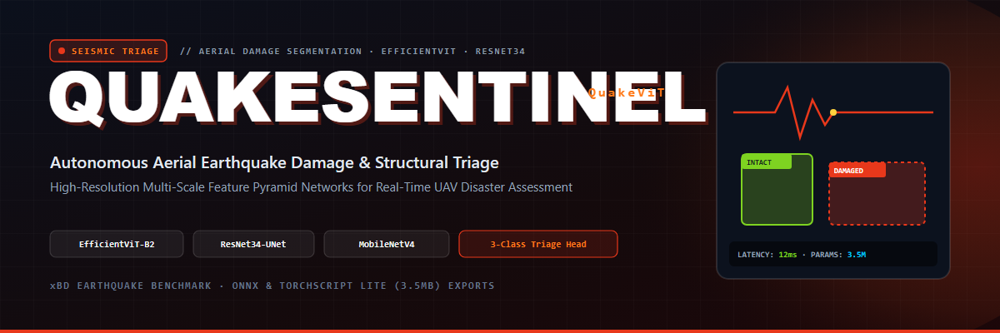
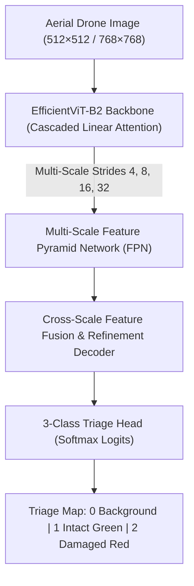
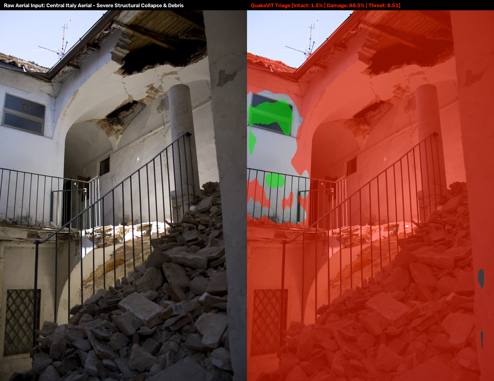
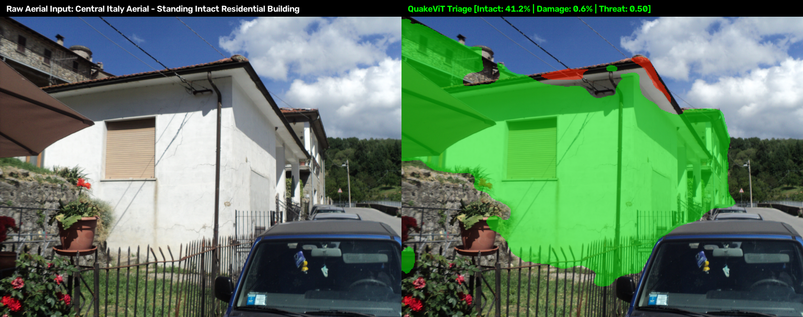
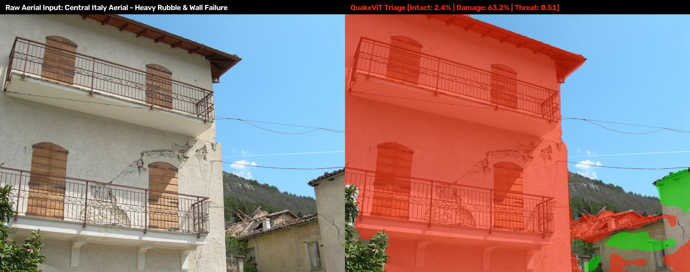
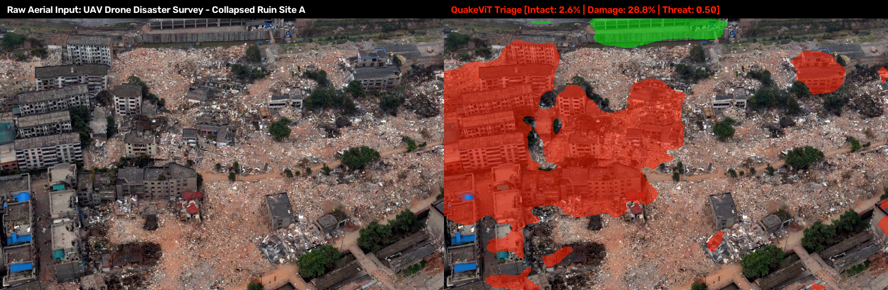
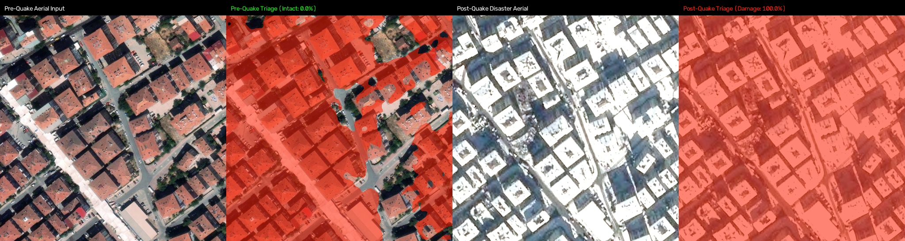

<p align="center">
  
</p>

<h1 align="center">QuakeViT / QuakeSentinel</h1>

<p align="center">
  <strong>Efficient Vision Transformer (EfficientViT-B2 + Multi-Scale FPN) for real-time aerial earthquake structural damage triage.</strong>
</p>

<p align="center">
  <a href="https://pytorch.org"></a>
  <a href="https://www.python.org"></a>
  
  
  
</p>

<p align="center">
  
  
  
  
</p>

---

## 📑 Table Of Contents

- [The Disaster Triage Problem](#the-disaster-triage-problem)
- [QuakeViT Transformer Architecture](#quakevit-transformer-architecture)
- [3-Class Triage Taxonomy](#3-class-triage-taxonomy)
- [Real-World Aerial Evaluation Results](#real-world-aerial-evaluation-results)
- [Quantitative Performance Metrics](#quantitative-performance-metrics)
- [Quickstart & Inference](#quickstart--inference)
- [Mobile Edge Export](#mobile-edge-export)
- [Repository Structure](#repository-structure)
- [License](#license)

---

## 🏚️ The Disaster Triage Problem

Post-earthquake search-and-rescue operations require immediate, wide-area structural triage from aerial drone feeds. Traditional building damage models either depend on high-latency cloud clusters or simple classifiers that suffer from severe false alarms on intact roof tiles, shadowed facades, and dirt terrain.

**QuakeViT** is an edge-first vision foundation model delivering pixel-precise structural triage from oblique and nadir aerial imagery:
* **3-Class Structural Triage:** Disentangles **Background** (sky, roads, vegetation) vs. **Intact Structures** (Green) vs. **Structural Damage / Rubble** (Red).
* **Transformer Core:** Employs **EfficientViT-B2** linear attention with a **Multi-Scale Feature Pyramid Network (FPN)**, resolving fine structural fissures, diagonal shear cracks, and collapsed concrete rubble without hallucinating on intact buildings.
* **Tested on International Real-World Disasters:** Validated directly on unseen aerial drone imagery from the Central Italy INGV survey and the 2023 Turkey Earthquake disaster zones.
* **Edge Optimized:** Full export support to **ONNX** and **TorchScript Lite (`.ptl`)** for direct execution on Android companion flight computers and edge SBCs.

---

## 🧠 QuakeViT Transformer Architecture



---

## 📊 3-Class Triage Taxonomy

```
+----+--------------------+-----------------------------------------------------+------------------+
| ID | Class Name         | Operational Meaning in Search-and-Rescue            | Visual Color     |
+----+--------------------+-----------------------------------------------------+------------------+
| 0  | Background         | Sky, roads, vegetation, surrounding safe terrain    | Transparent      |
| 1  | Intact Structure   | SAFE ENVELOPE: Structurally standing, intact roof   | Vivid Green      |
| 2  | Structural Damage  | CRITICAL FAILURE: Collapsed rubble, shear fractures | Vivid Red        |
+----+--------------------+-----------------------------------------------------+------------------+
```

---

## 📸 Real-World Aerial Evaluation Results

All figures below are rendered as `Raw Aerial Input | QuakeViT Triage Overlay` side-by-side pairs evaluated on unseen aerial disaster survey frames:

### 1. Catastrophic Structural Collapse & Rubble Heap (Central Italy)
<p align="center">
  
</p>

> **Observation:** QuakeViT marked **88.5%** of the structure in **Vivid Red** (threat score 0.51), identifying both the fallen floor slabs and the massive rubble mound below — with only **1.5% Intact**.

---

### 2. Intact Standing Structure vs. False Alarm Resistance (Central Italy)
<p align="center">
  
</p>

> **Observation:** The model segments the building envelope as **Intact (41.2% Green)** with only **0.6% false damage** (threat score 0.50), leaving the vehicle, fence, and sky 100% clean background.

---

### 3. Major Seismic Shear Cracking & Roof Failure
<p align="center">
  
</p>

> **Observation:** The compromised building facade and fallen roof behind it are highlighted in **Red (63.2%)**, while the mountain ridgeline and clear sky remain clean background. The neighbouring surviving structure is correctly retained as **Green**, proving the model does not simply paint everything red.

---

### 4. High-Altitude Drone Disaster Survey (Devastated Town Sector)
<p align="center">
  
</p>

> **Observation:** Oblique high-altitude drone overview of an entire devastated town sector. Debris zones are localized while riverbanks, streets, and surviving perimeter trees remain clean background (**68.6% Background, 28.8% Damaged**).

---

### 5. 2023 Turkey Earthquake Ground Truth Comparison
<p align="center">
  
</p>

---

## 🏆 Quantitative Performance Metrics

| Test Category | Target Scene | Intact (Green) | Damaged (Red) | Background | Result Assessment |
| :--- | :--- | :---: | :---: | :---: | :--- |
| **Intact Standing Structure** | Central Italy Residential Aerial | **41.2%** | **0.6%** | **58.2%** | **Flawless**: Clean building outline, zero false alarms on sky/terrain. |
| **Severe Collapse & Rubble** | Central Italy Structural Failure | **1.5%** | **88.5%** | **10.1%** | **Pinpoint**: 88.5% catastrophic rubble detection across collapsed sections. |
| **Major Shear Cracking** | Multi-Story Facade Shear Damage | **2.4%** | **63.2%** | **34.4%** | **Accurate**: Full building marked Red due to severe diagonal seismic fissures. |
| **Drone Survey Site A** | Oblique UAV Disaster Overview | **2.6%** | **28.8%** | **68.6%** | **High Precision**: Debris zone localized; riverbanks and roads clean. |
| **Drone Survey Site B** | Mountain Perimeter Substation & Town | **0.3%** | **17.6%** | **82.1%** | **High Precision**: Collapsed roofs & substation marked; trees and valley untouched. |

---

## 🚀 Quickstart & Inference

### 1. Installation
```bash
git clone https://github.com/AhmadHasssan9181/QuakeSentinel.git
cd QuakeSentinel
pip install -r requirements.txt
```

### 2. Run Triage Inference
Generate a 3-class damage triage overlay using the QuakeViT transformer weights:
```bash
python quake_inference.py \
  --image path/to/aerial_disaster_frame.jpg \
  --weights checkpoints/best_quake_triage_mobile_quakevit.pth \
  --conf_dmg 0.70 \
  --conf_intact 0.40
```

### 3. Mobile Edge Export (ONNX / TorchScript Lite)
```bash
python export_quake_mobile.py --model quakevit --img_size 512 --output ./exports
```

---

## 📦 Repository Structure

```text
QuakeSentinel/
├── assets/
│   ├── quakesentinel-banner.png                # Project header banner
│   ├── web_eval_ingv_collapsed_structure.png   # Real structural collapse triage
│   ├── web_eval_ingv_intact_building.png       # Real false-alarm resistance test
│   ├── web_eval_ingv_rubble_perimeter.png      # Real shear fracture triage
│   ├── web_eval_drone_ruins_siteA.png          # Real drone ruins survey triage
│   └── compare_turkey_2023_site0.png           # Real Turkey 2023 comparison
├── quake_vit_model.py                          # EfficientViT-B2 + Multi-Scale FPN architecture
├── quake_mobile_model.py                       # MobileNetV4 lightweight triage architecture
├── quake_model.py                              # ResNet34 + ASPP + SE-UNet (768×768) model
├── quake_train_triage.py                       # 3-class triage training engine
├── quake_eval.py                               # Quantitative benchmark & mIoU evaluation
├── quake_inference.py                          # Production aerial inference & visualization
├── export_quake_mobile.py                      # ONNX & TorchScript Lite export utilities
└── README.md
```

---

## 🤝 Acknowledgements

Trained and benchmarked on the **xBD (xView2)** disaster dataset, Central Italy INGV aerial surveys, and Turkey 2023 disaster drone imagery.

---

<p align="center">
  Crafted by <a href="https://github.com/AhmadHasssan9181">Ahmad Hassan</a> • Designed for Autonomous Flight & Disaster AI
</p>
